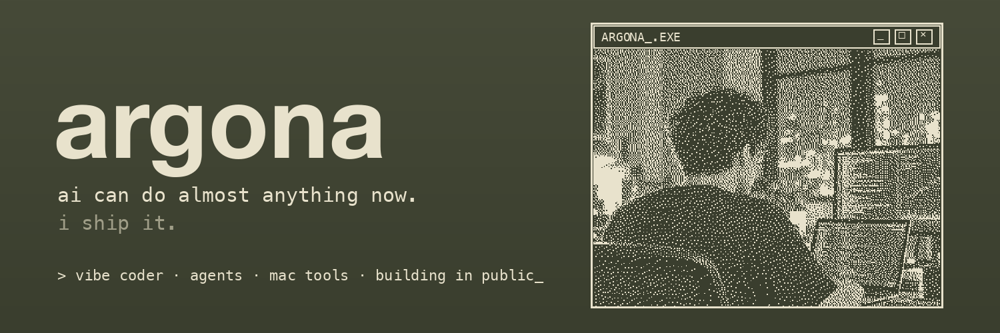

<p align="center">
  
</p>

<p align="center">
  <a href="https://x.com/Argona0x"></a>
  <a href="https://t.me/argona_print"></a>
  <a href="https://t.me/+r0clI4-MMC03ZjAy"></a>
</p>

<p align="center">
  <b>18, vibe coder.</b> I ship agent tools, Mac utilities and growth systems with AI agents.<br>
  33K+ on X · building in public · DMs open for collabs
</p>

<br>

### `> ls ~/shipped`

| | project | what it does |
|---|---|---|
| 🛰 | **[stampede](https://github.com/Argona7/stampede)** | Read-only explorer of observed wallet rotations on Robinhood Chain · 140★ |
| 🧭 | **[novpn](https://github.com/Argona7/novpn)** | Keep the VPN on, chosen sites go through your real ISP on macOS. Russia mode, instant switch, pf kill switch |
| ⌨️ | **[ru2en](https://github.com/Argona7/ru2en)** | System-wide RU → EN translator for macOS: select text, double-tap Cmd+C, native English in under a second |
| 🔀 | **[tailscale-route-fix](https://github.com/Argona7/tailscale-route-fix)** | macOS daemon that keeps Tailscale working next to Happ, AmneziaVPN, Outline and OpenVPN |
| 🤝 | **[coagent](https://github.com/Argona7/coagent)** | Hooks that let Claude Code and Kimi CLI know what each other is doing on the same machine, no polling |
| 🎙 | **[youtube-transcript-harvester](https://github.com/Argona7/youtube-transcript-harvester)** | Local YouTube transcripts with WhisperKit plus ready-to-analyse bundles for Claude Code |
| 🍪 | **[cookie-exporter](https://github.com/Argona7/cookie-exporter)** | Local-only macOS CLI that exports Chromium cookies with an explicit preview and confirmation |
| 🚀 | **[when-the-link-to-earth-is-severed](https://github.com/Argona7/when-the-link-to-earth-is-severed)** | Offline-first clinical language models for crewed deep-space missions: paper, figures and an HTML build |

### `> cat ~/stack`

```text
agents   Claude Code · Codex · Cursor · Grok
code     Python · FastAPI · single-file HTML · Hammerspoon
visuals  Higgsfield · GPT Image · vhs
infra    MacBook for vibes · Mac mini for prod · Tailscale
```

